# The table: journal of the redesign

What changed on the play table, step by step, with a picture or a recording of each step.
Newest state first, then the steps in the order they were built. Each step is one commit, so any of them
can be undone on its own with a revert.

Recordings were captured at quarter speed in a headless browser and sped back up, so they stutter more than a real
phone does. Screenshots are 760×340 or 844×390 (phone landscape), 390×844 (phone portrait) and 1440×900 (desktop).

## Where things stand

| | |
|---|---|
| Live site | https://169-58-71-242.sslip.io/pod/ runs `main`. It has steps 1 to 5 below (commit `9544657`). |
| Work branch | `design`. Newer steps land here first and reach the live site only when `design` is pushed to `main`. |
| Before all this | Tag `before-table-redesign` (commit `91cb3df`). |
| Undo a step | `git revert <commit>` on `main` and push. The server follows `main` forward only, so never force-push. |
| Checks | Seven commands, listed at the end. All pass at every commit below. |

### What is live (after step 5)

Landscape is the main design. Both battlefields take the whole width, rows are centred, and every control floats.

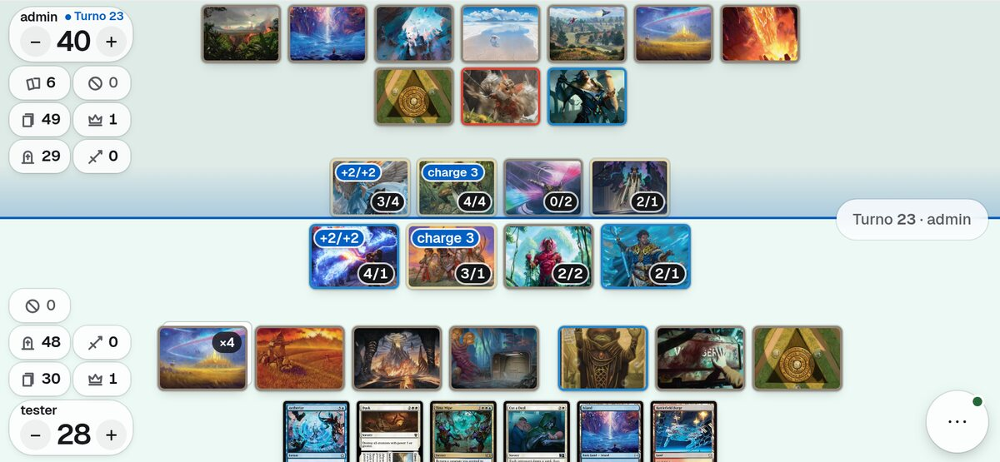
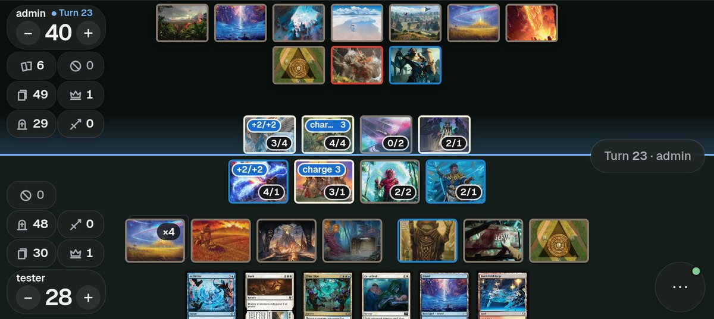

One round button opens the actions as bubbles. Passing the turn arms for 1.5 s and can be cancelled.

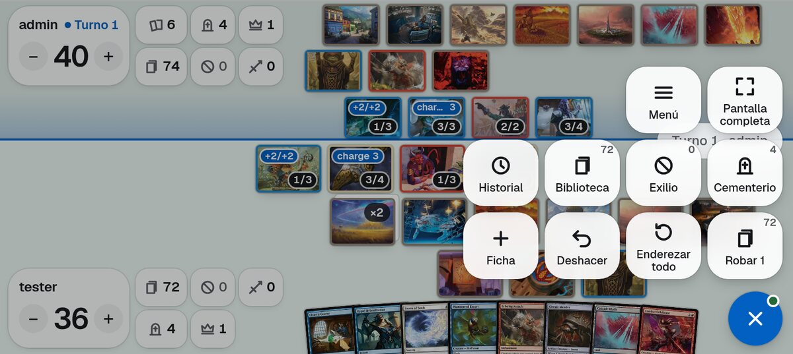
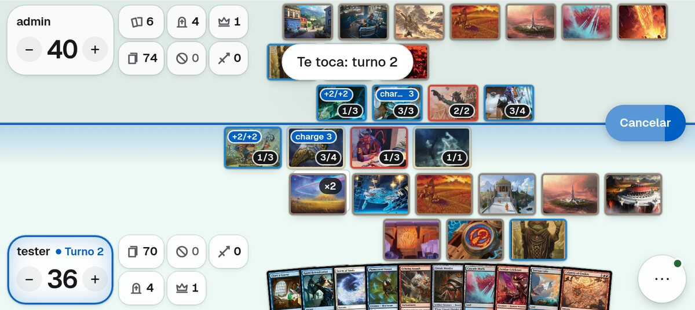

Portrait and desktop share the same controls.

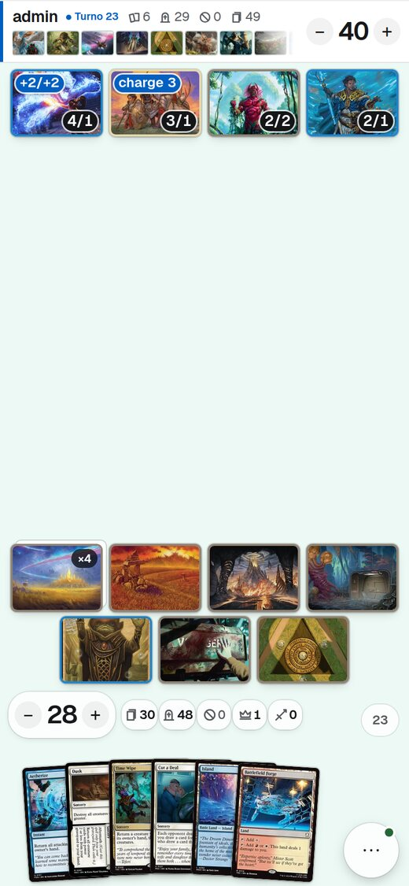 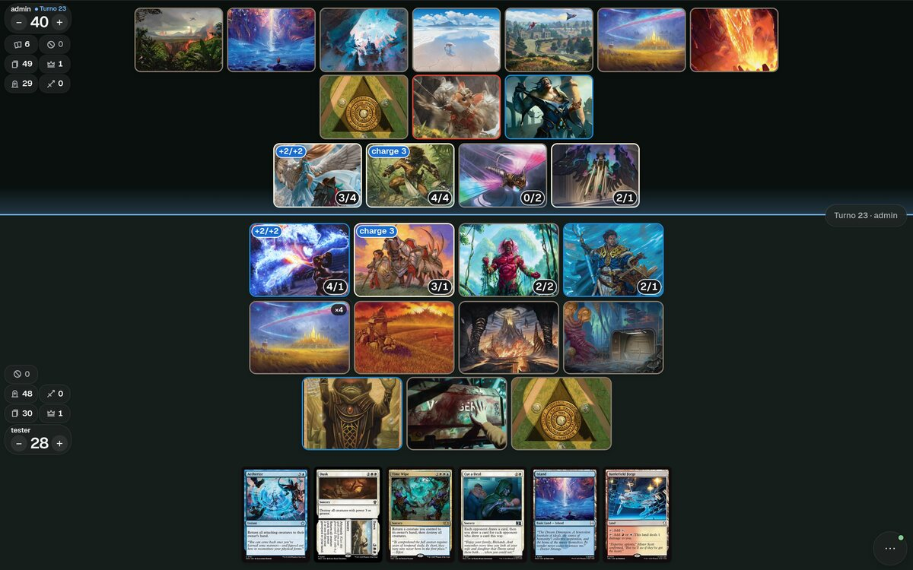

### Known weak spots (told to Jorge, not fixed yet)
- On short phones, landscape tiles are 12 to 16% smaller than they were with a side rail, because every row is
  centred on the screen and must clear the corner pills on both sides.
- An opponent with many lands gets three rows instead of two at 760×340.
- Portrait leaves a large gap between your creatures and your lands when the board is small.
- The multi-select bar covers the opponent's life pill in landscape.
- The menu still lists Log and Full screen, which the bubbles also have.
- Nothing here was checked on a real phone by the developer; Jorge and his testers are doing that.

## The starting point

Cards blinked from one place to another, every tap waited for the server, and phone landscape put two half-width
boards side by side with cards 32 to 41 px wide.

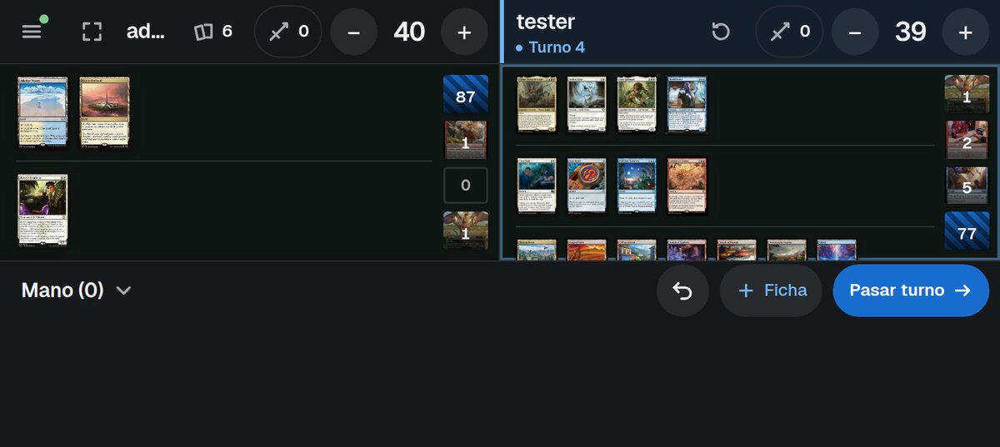
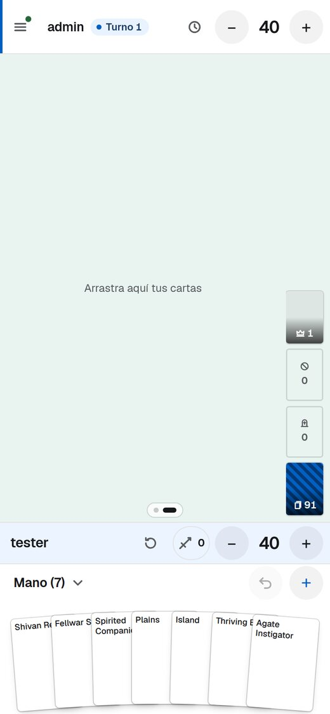

## Step 1 — Cards glide, actions apply at once (`acc3d98`)

- A card keeps its id when it moves; only a shuffle issues new ids. Hidden names behave as before.
- Each card keeps one element on the page and glides to its new place. Nothing animates under reduced motion.
- Tap, untap all, life, counters, commander damage, attach and visible moves show before the server answers.
  A rejected action glides back. `scripts/test_table_predict.js` replays random games through the server's
  reducer and the browser's predictor and fails if they disagree.
- Undo is one button; the toast after every action is gone. Passing the turn has a cancel window.

Play, tap, and undo on a phone:

  

The other player's card arriving, as you see it:


## Step 2 — Drag at once, slide to see cards large, quick zones (`ae222a1`)

Asked for after the first phone test.

- A finger on a card that moves drags it at once.
- Sliding over cards from an empty spot shows each one large. A pressed hand card is shown large too.
- While a card is dragged, a tray offers hand, graveyard, exile and library top or bottom.
- A draw button, and a full-screen button on every phone.

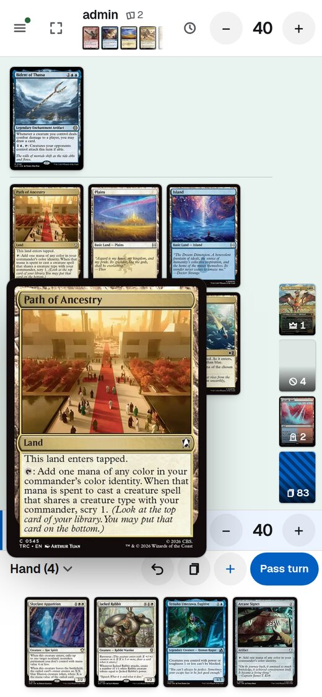 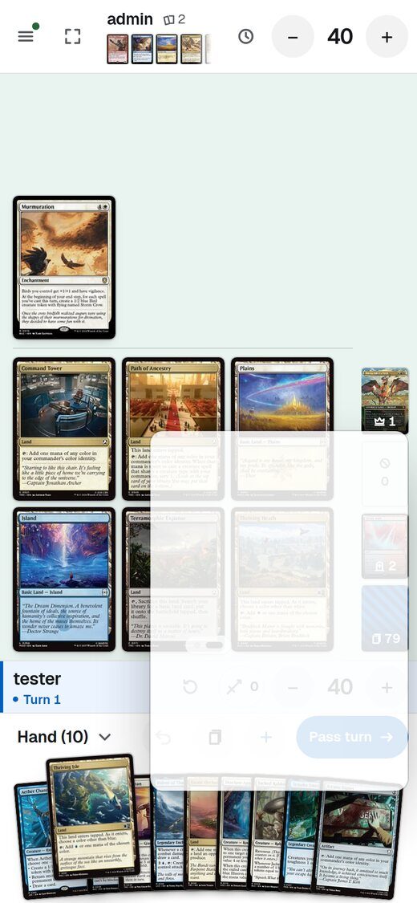 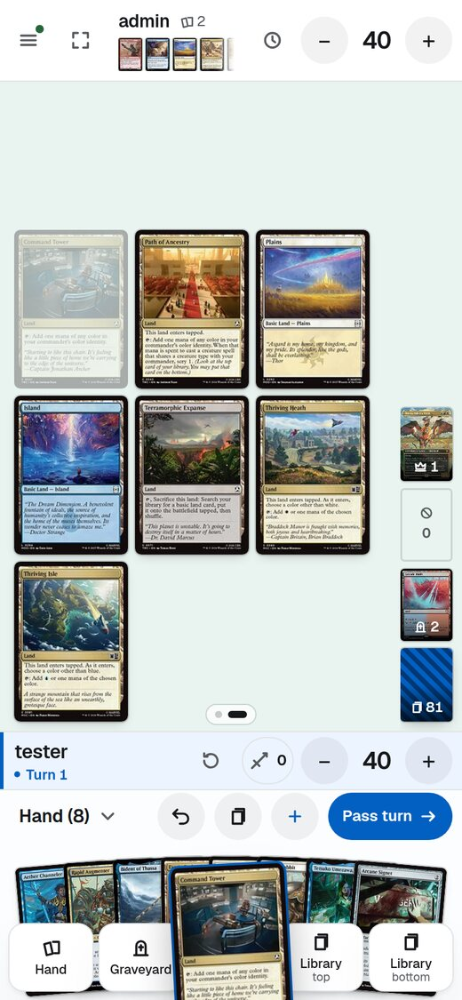 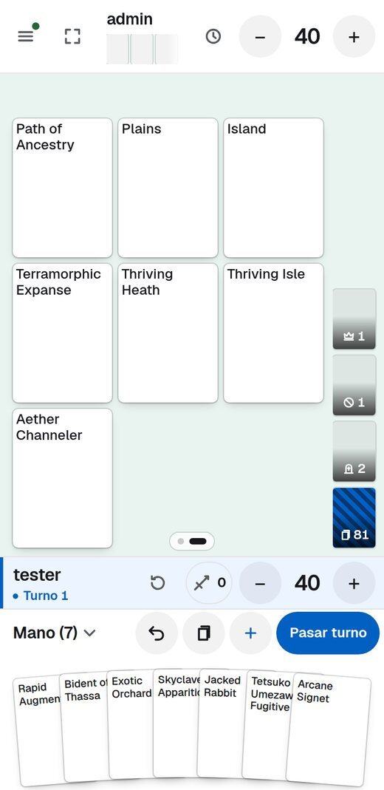

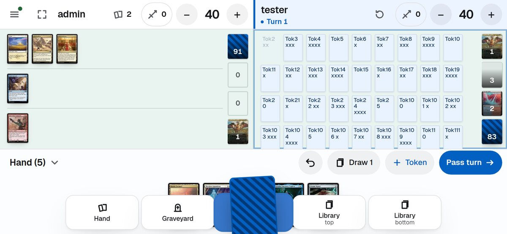

## Step 3 — Phone landscape, first attempt: stacked boards with a side rail (`7ff7e1e`)

Opponent on top, you at the bottom, a left rail for life and buttons, piles on the right, a hand that peeks.
Jorge's verdict: better, but the rail takes too much space. Replaced in step 5.

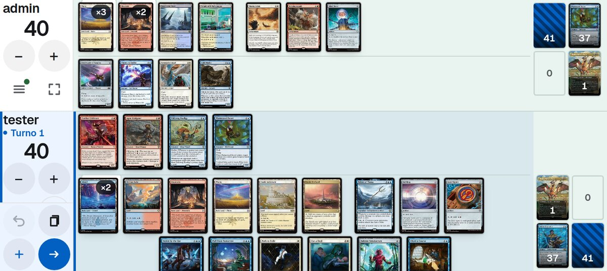
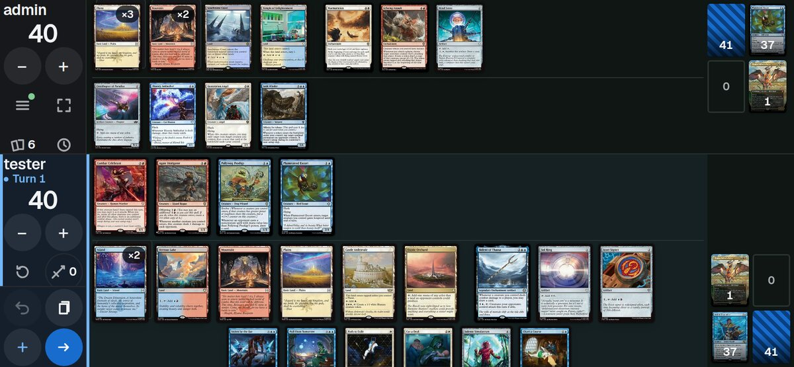
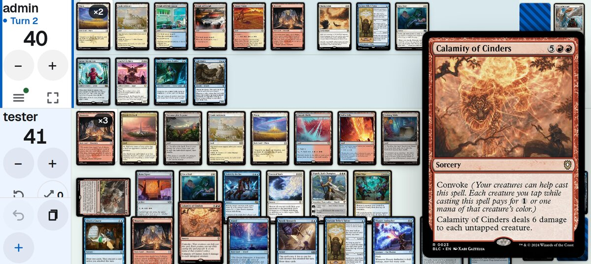

## Step 4 — Permanents as art tiles; press to enlarge (`617384f`)

- A permanent is its artwork in a wide tile with a colour frame and power/toughness or loyalty. No card text:
  the full card shows when you press or hover.
- A tapped permanent tilts and dims instead of turning 90 degrees.
- Press a card to see it large, move away to drag it, quick tap to tap it, double tap for its actions.
  "Select several" moved into the action bar.

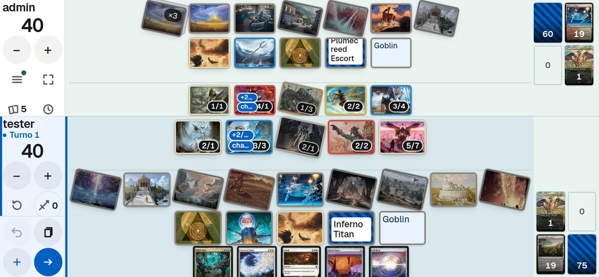
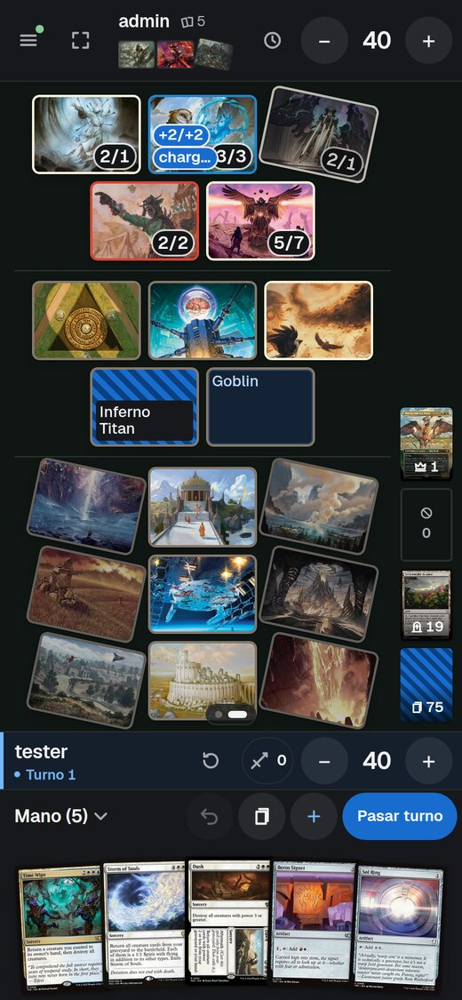 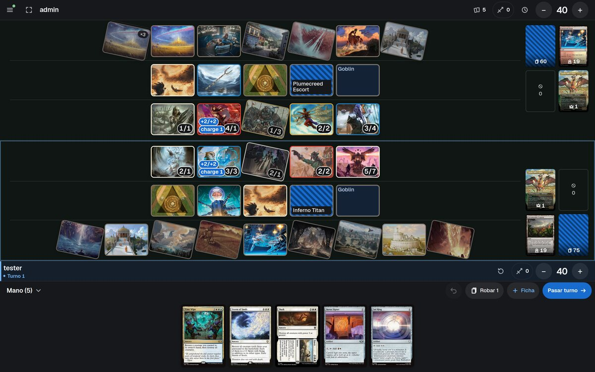

## Step 5 — The battlefield takes the whole screen (`9544657`)

- No rails, pile columns or hand head. Rows are centred on the screen.
- A life pill per player with zone chips beside it. A chip opens its pile, takes drops, and is where cards fly to.
- Pass turn on the right edge. One translucent button opens the bubbles.

The pictures are at the top of this page. A crowded board at 760×340:

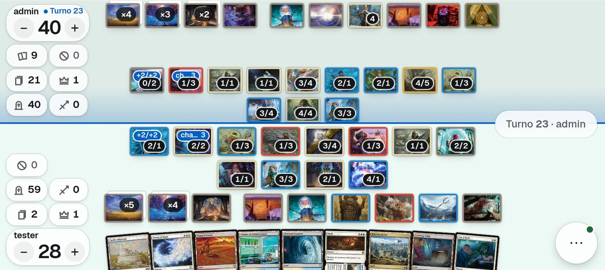

## What comes next, in this order

1. Games of 2 to 6 players. The screen always shows two battlefields, yours and one other player's.
2. The rest of the handling: drag physics, the hand as an arc, the draw flip, shuffle and dice.
3. The look: playmat, card shadows, optional sound.
4. Token lookup with art and power/toughness.
5. Fixes from Jorge's and his testers' phone tests, as they arrive.

New steps are added below as they are built.

## The checks

Run from the repository root; all must pass before a commit.

```
node scripts/test_engine_parity.js
node scripts/test_i18n.js
node scripts/test_table_log.js
node scripts/test_table_predict.js
python3 scripts/tier_rules.py --calibrate
cd server && python -m pytest
```
