# The table: journal of the redesign

What changed on the play table, step by step, with a picture or a recording of each step.
Newest state first, then the steps in the order they were built. Each step is one commit, so any of them
can be undone on its own with a revert.

All recordings are in [`for_human_revision/`](../../for_human_revision/), as videos, one folder per step.
Recordings were captured at quarter speed in a headless browser and sped back up, so they stutter more than a real
phone does. Screenshots are 760×340 or 844×390 (phone landscape), 390×844 (phone portrait) and 1440×900 (desktop).

## Where things stand

| | |
|---|---|
| Live site | https://169-58-71-242.sslip.io/pod/ runs `main`. Every finished step is pushed there. |
| Work branch | `design`. A step is built and checked here, then pushed to `main`. |
| Before all this | Tag `before-table-redesign` (commit `91cb3df`). |
| Undo a step | `git revert <commit>` on `main` and push. The server follows `main` forward only, so never force-push. |
| Checks | Seven commands, listed at the end. All pass at every commit below. |

### What changed on 2026-11-13 (steps 11 to 17)

Second round of the day, all committed on `design`, not yet on `main` or the live site:

- A double tap opens a card's actions reliably, holding a card and letting go does too, and the action bar is a compact 3-column panel in landscape (step 11).
- Battlefield tiles show the top of the real printed card: its title bar with name and mana cost, then the art (step 12).
- Two-faced cards turn on the battlefield and can be played on their other face from the hand (step 13).
- The token sheet offers your deck's tokens and other decks' tokens, for any player; Copy and a counter row are in the action bar (step 14).
- A new game opens a lobby with each player's deck, its Main, Sideboard and Maybeboard, and Ready; the Games tab picks players with chips (step 15).
- The library sheet's count starts at 1 and has steppers and quick numbers (step 16).
- A card can be sent to a chosen position in your library (step 17).

Nothing here was tested on a real phone. Recordings: folders `10` to `13` in `for_human_revision/`. Only the two titles clips (and the other clips of folder `11`, re-recorded with them) show the new card-top tiles; the clips in the other folders were recorded before it and still show the earlier tiles.

### What is live (after step 10)

Games of 2 to 6 players; the pictures of that are under steps 6 and 7. The two-player table:

Landscape is the main design. Both battlefields take the whole width, rows are centred, and every control floats.

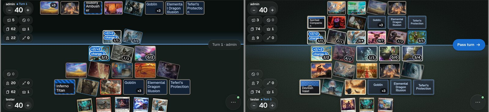

The right half of that picture is the table now; the left half is the same screen one step earlier. The pictures below are from step 5, before the mat and the shadows:


One round button opens the actions as bubbles. Passing the turn arms for 1.5 s and can be cancelled.


Portrait and desktop share the same controls.

 

Videos of the current two-player table are in [`for_human_revision/05-floating-layout/`](../../for_human_revision/05-floating-layout/); of a four-player game, in [`06-multiplayer/`](../../for_human_revision/06-multiplayer/).

### Known weak spots (told to Jorge, not fixed yet)
- On short phones, landscape tiles are 12 to 16% smaller than they were with a side rail, because every row is
  centred on the screen and must clear the corner pills on both sides.
- An opponent with many lands gets three rows instead of two at 760×340.
- Portrait leaves a large gap between your creatures and your lands when the board is small.
- The multi-select bar covers the opponent's life pill in landscape.
- The menu still lists Log and Full screen, which the bubbles also have.
- Nothing here was checked on a real phone by the developer; Jorge and his testers are doing that.

## The starting point

Cards blinked from one place to another, every tap waited for the server, and phone landscape put two half-width
boards side by side with cards 32 to 41 px wide.


## Step 1 — Cards glide, actions apply at once (`acc3d98`)

- A card keeps its id when it moves; only a shuffle issues new ids. Hidden names behave as before.
- Each card keeps one element on the page and glides to its new place. Nothing animates under reduced motion.
- Tap, untap all, life, counters, commander damage, attach and visible moves show before the server answers.
  A rejected action glides back. `scripts/test_table_predict.js` replays random games through the server's
  reducer and the browser's predictor and fails if they disagree.
- Undo is one button; the toast after every action is gone. Passing the turn has a cancel window.

Play, tap, and undo on a phone:

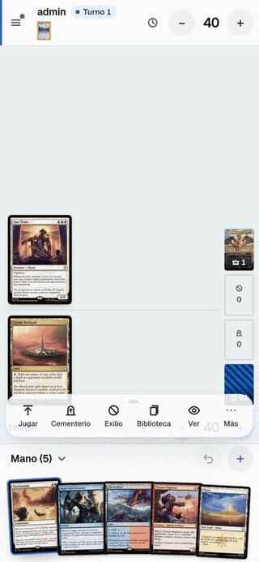 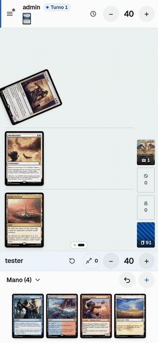 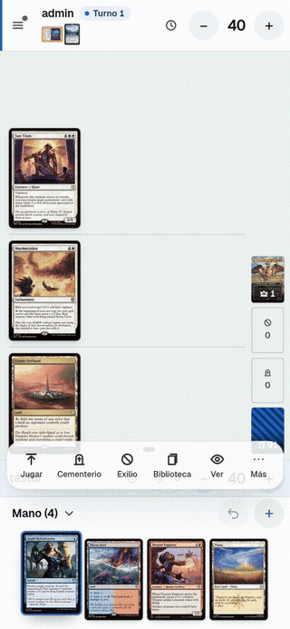

The other player's card arriving, as you see it:

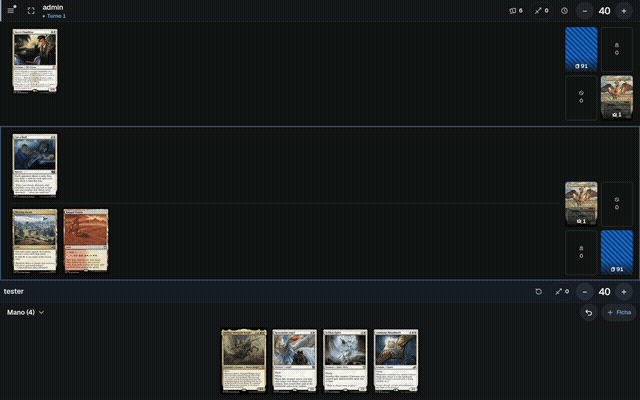
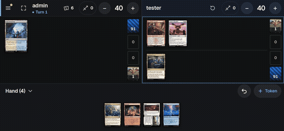

## Step 2 — Drag at once, slide to see cards large, quick zones (`ae222a1`)

Asked for after the first phone test.

- A finger on a card that moves drags it at once.
- Sliding over cards from an empty spot shows each one large. A pressed hand card is shown large too.
- While a card is dragged, a tray offers hand, graveyard, exile and library top or bottom.
- A draw button, and a full-screen button on every phone.

   


## Step 3 — Phone landscape, first attempt: stacked boards with a side rail (`7ff7e1e`)

Opponent on top, you at the bottom, a left rail for life and buttons, piles on the right, a hand that peeks.
Jorge's verdict: better, but the rail takes too much space. Replaced in step 5.


## Step 4 — Permanents as art tiles; press to enlarge (`617384f`)

- A permanent is its artwork in a wide tile with a colour frame and power/toughness or loyalty. No card text:
  the full card shows when you press or hover.
- A tapped permanent tilts and dims instead of turning 90 degrees.
- Press a card to see it large, move away to drag it, quick tap to tap it, double tap for its actions.
  "Select several" moved into the action bar.


 

## Step 5 — The battlefield takes the whole screen (`9544657`)

- No rails, pile columns or hand head. Rows are centred on the screen.
- A life pill per player with zone chips beside it. A chip opens its pile, takes drops, and is where cards fly to.
- Pass turn on the right edge. One translucent button opens the bubbles.

The pictures are at the top of this page. A crowded board at 760×340:


## Step 6 — The server runs games of 2 to 6 players (`0a539b8`)

Nothing to see on screen in this step.

- Seats are 1 to N. Cards that were known to "both" players are known to every player.
- Commander damage is kept per player it comes from, because two players may run the same commander.
- The turn goes to the next player in order who is not out. A player can mark themselves out or back in.
- The limit of 600 is on tokens, not on all cards.
- The predictor and its parity test cover 2, 3, 4 and 6 players. The fuzz test checks that no hidden card name
  reaches any player, with 2, 3 and 6 players.
- With 6 players and 100-card decks, an action takes 3.8 ms on average and the stored game is about 205 KB.

Games saved before this step used the old commander-damage shape and had to be ended.

## Step 7 — The screen for 3 to 6 players (`869d081`)

The screen still shows two battlefields: yours and one other player's.

- The top battlefield follows the turn. Choosing someone by hand holds until the next turn change.
- A strip of small pills shows every other player's name and life, whose turn it is, and who is out. Tap one
  to see their battlefield. The same players are bubbles in the action menu.
- A player who is not on top glows when they act, and their life change floats at their pill.
- One commander-damage chip per player, showing the highest damage from a single commander. It opens a sheet
  with every opponent's commanders.
- Giving control asks which player. "I'm out of the game" is in the menu.
- The Partidas form invites one to five pod members.

The top following the turn, and tapping through the strip:

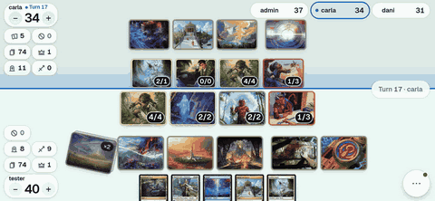
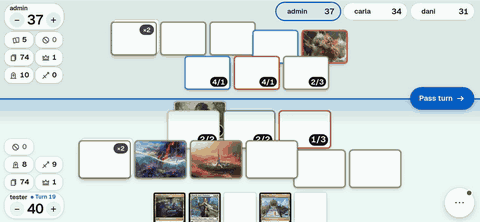

Four players, and six with the bubbles open:

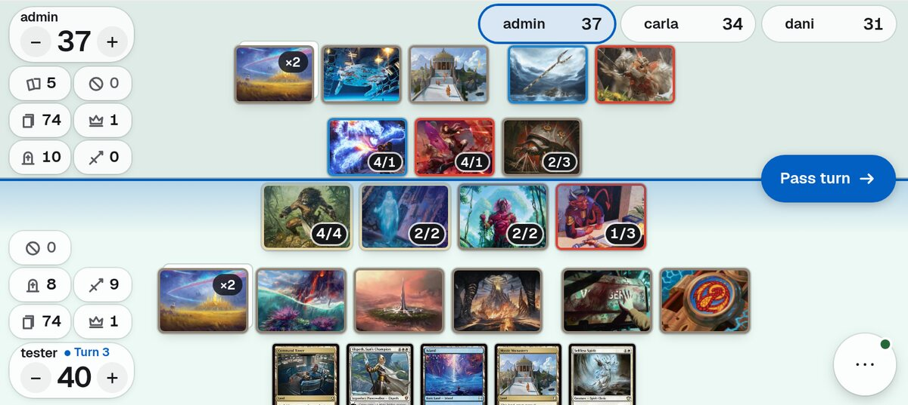
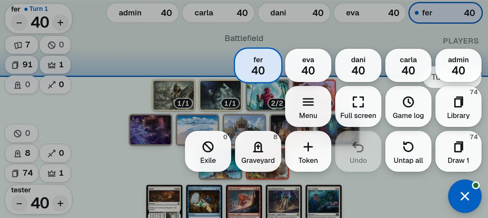

A player who is out, and giving control to a chosen player:

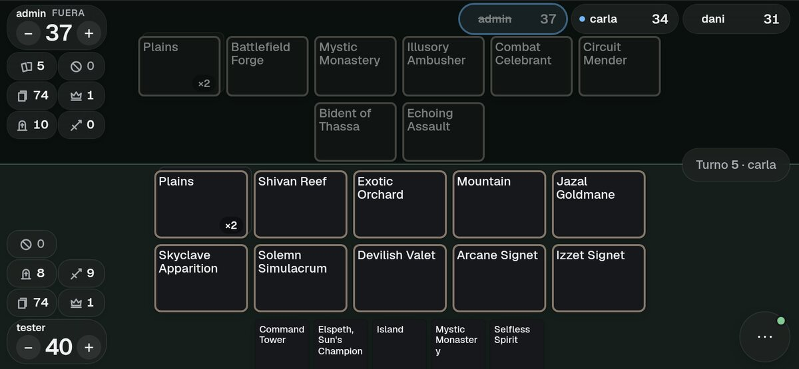
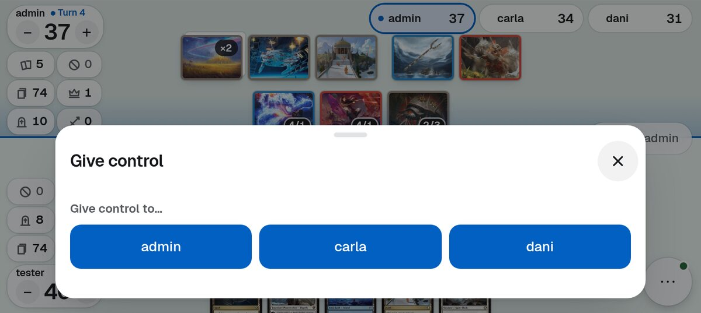

On a phone held upright: switching players, six players, commander damage, the lobby, and the invitation form.

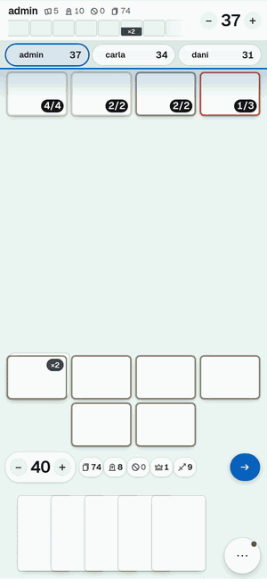 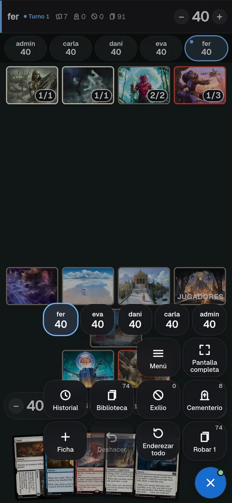 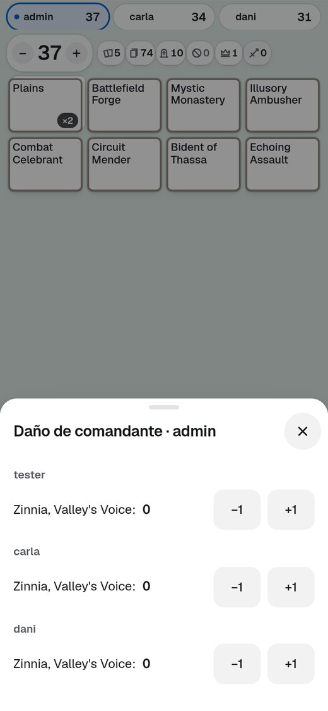 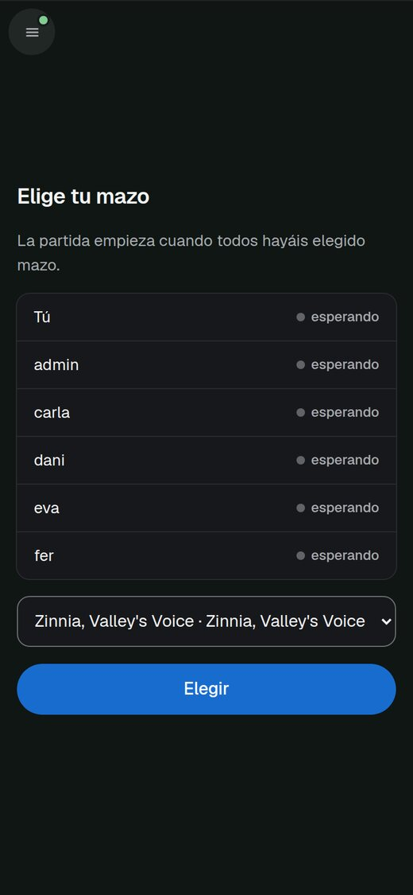 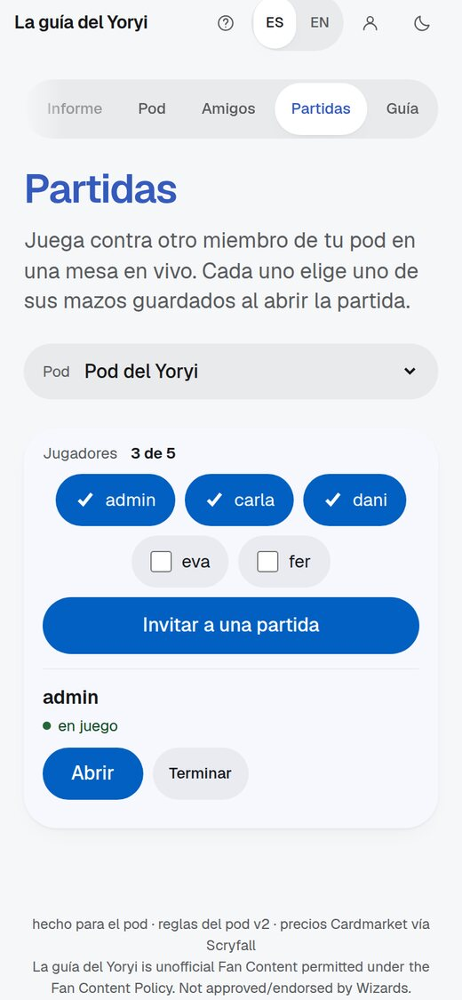

Not checked or weak in this step:
- Some screenshots show card names instead of art because the art had not loaded in the test browser.
- The strip's pills are bright in the light theme.
- The first-time hint for the strip, and giving control in portrait, were not exercised.
- With three or more players, a card moved into another player's hand waits for the server instead of moving at once.

## Step 8 — The feel layer (`fd47e63`)

- **Drag.** The dragged card is a copy of its own tile. It lifts from its slot, tilts with the speed of the
  finger, and is pulled into zone chips, tray targets and hosts when it comes near. On release it carries on
  into its new place. Dropped on nothing, it flies back.
- **Hand.** Cards sit on an arc. The raised card straightens and grows and its neighbours part. With 20 cards on
  a phone the raised card is 95 px wide or more.
- **Flights.** A played card arcs from the hand. A card returning to the hand lands at its fan angle.
- **Draw.** A card you draw flips face up on the way. The other player's draw flies as a card back.
- **Untap all** ripples across your permanents. A **shuffled** library's chip riffles. A **die** tumbles before
  it settles and a coin spins; a screen reader hears the result once, when it lands.
- The multi-select bar no longer covers a life total. The menu no longer repeats Log and Full screen.

Nothing in this step animates under reduced motion.

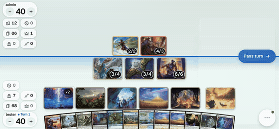
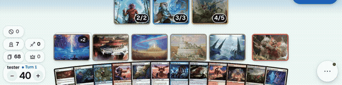
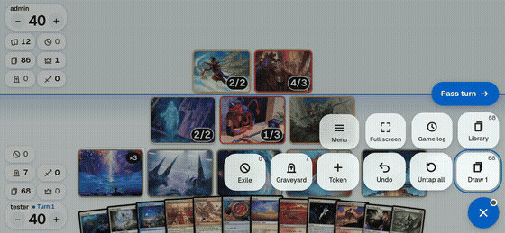

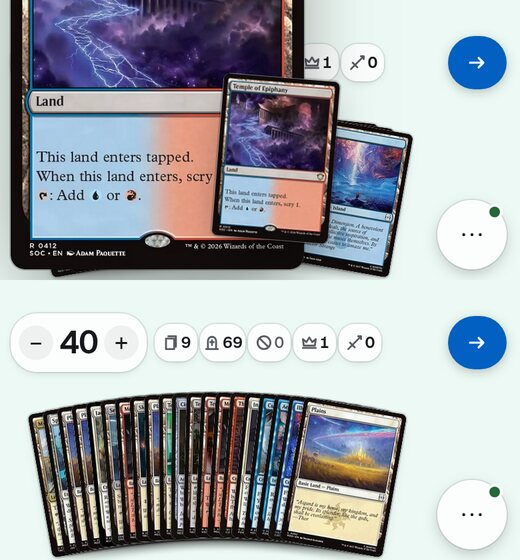 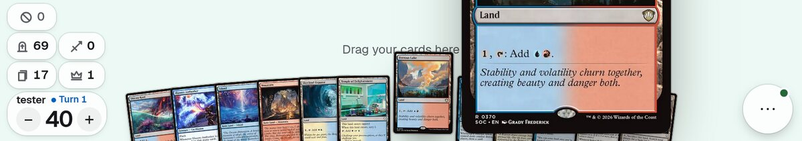

Not checked or weak in this step:
- A card dragged from the hand changes from the full card to the wide art tile at the moment of release.
- When several cards are dragged together, only the one under the finger flies from where you let go.
- The pull radius near a chip (about 40 px) was chosen by eye, not tuned with a finger.
- The clips were captured with the pointer moving four times slower than a hand, so the tilt in them is milder
  than it will feel.
- The untap ripple was verified with 3 to 6 permanents, not more.

## Step 9 — The look, and optional sound (`af60d2c`)

- **The table is a mat:** grain, a vignette and a soft light at the centre, in both themes. Each player's half
  is a tone over it, the centre line is a seam, and the half whose turn it is is lit from the seam.
- **Cards have depth:** three shadow levels (resting, lifted, held), with a rim light on the dark table.
  Corners match real cards. A held or enlarged card has a faint sheen that shifts as a dragged card tilts.
- **One card back** for face-down cards, the draw flip and other players' draws.
- **Tokens** are a tinted panel with the name centred. Names without art wrap by word and shrink with the tile.
- **Controls recede:** pills, chips, the strip and the action button share one glass treatment.
- **Sound, off by default.** Menu, Sound, On. Short synthesized sounds for tap, untap, play, draw, shuffle,
  your turn, a roll and a rejected action. Nothing is loaded and no audio is set up while it is off.

Before (left) and after (right), in the light and the dark theme. The two boards are different games.

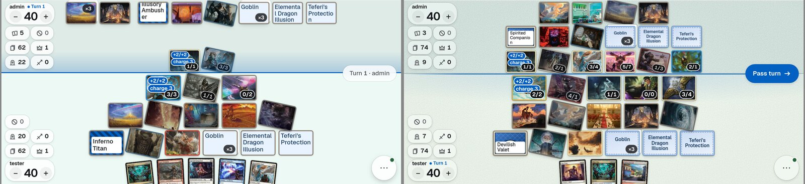


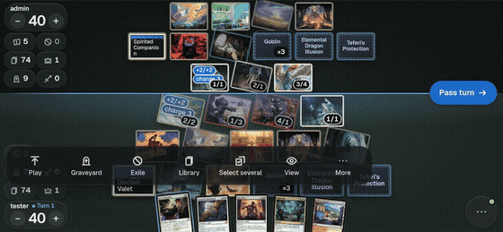

Close-ups: tokens and names without art at three tile sizes, frame colours, the card back, counters and P/T.

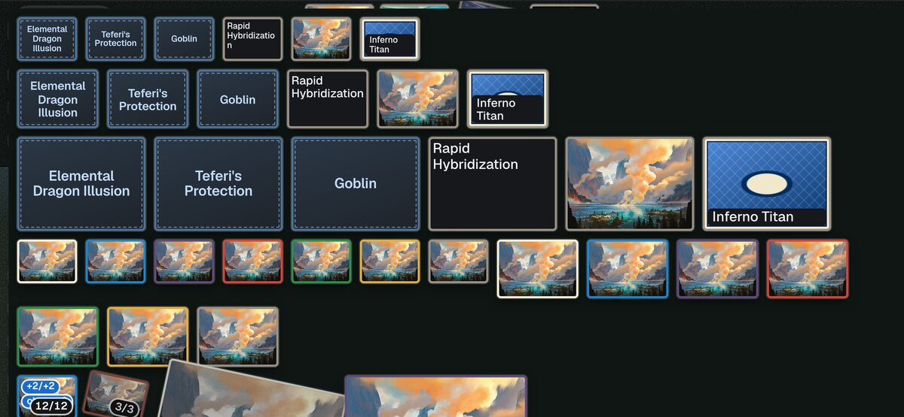
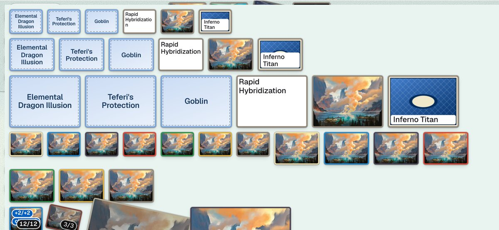

Four players, and portrait before and after:

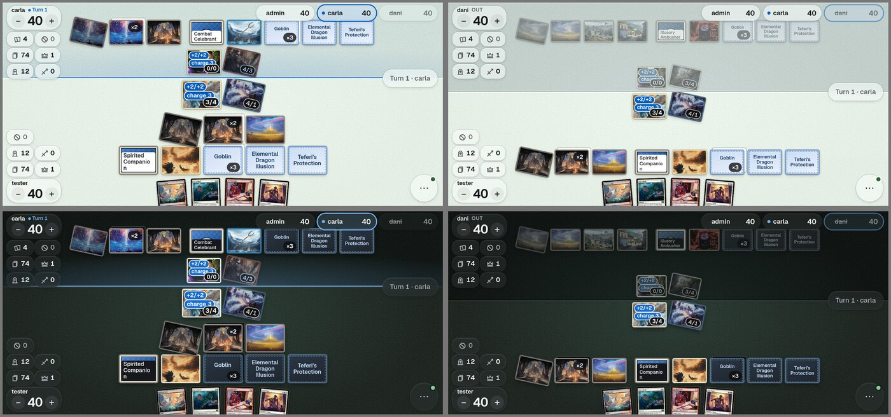
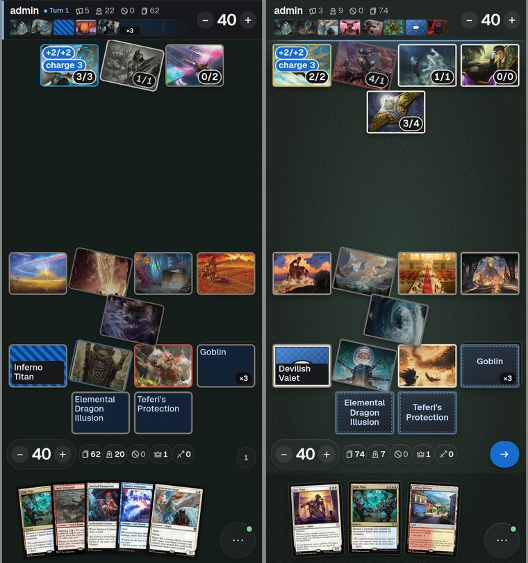

Measured contrast of text on the new surfaces: life totals 15.0 (light) and 14.5 (dark), chip counts 15.6 and
13.2, the turn tag 5.3 and 7.4, token names 9.1 and 10.4.

Not checked or weak in this step:
- Sound was verified by counting the audio calls in a test browser. Nobody has heard it yet.
- The sheen is faint and hard to see on light art.
- A very long single word on the smallest tile still breaks mid-word in the test browser, which has no
  hyphenation; a real phone should hyphenate it.
- Whether the mat adds repaints while cards fly could not be told: the counts varied too much between runs.
  The drag loop's frame time did not change (16.7 ms on average).

## Step 10 — Token lookup (`f0e0e07`)

- **A dataset of every token:** `data/tokens.json`, 1019 tokens from Scryfall, built by
  `scripts/fetch_tokens.py`. 208 KB, 75 KB when compressed. It is loaded only when needed.
- **Tokens look like permanents:** art, a frame in their colours, power/toughness, and a TOKEN mark so they are
  never taken for a real card. They sort with creatures or other permanents and stack when identical.
- **The token sheet:** search by name, type, colour or "2/2". The tokens your own visible cards make come first,
  then the ones you made this visit. A count stepper. A custom name at the end for anything missing.
  Creating keeps the sheet open, since making several kinds in a row is common.
- **"One more"** in the action bar of a token already in play.
- If the dataset cannot load, tokens are name panels as before and the sheet offers the custom name.

Games saved before this step keep working.

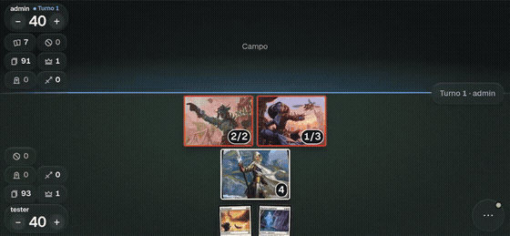

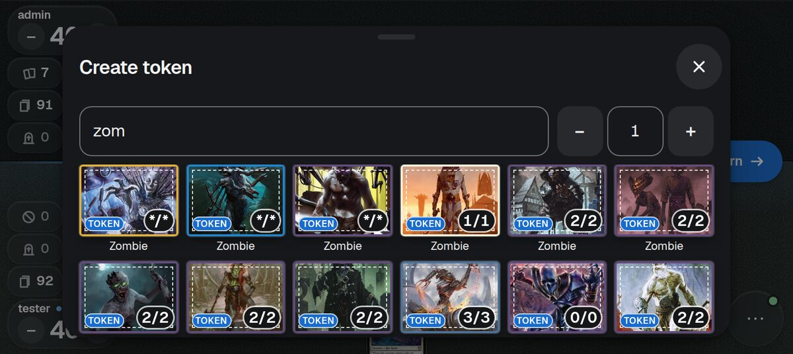
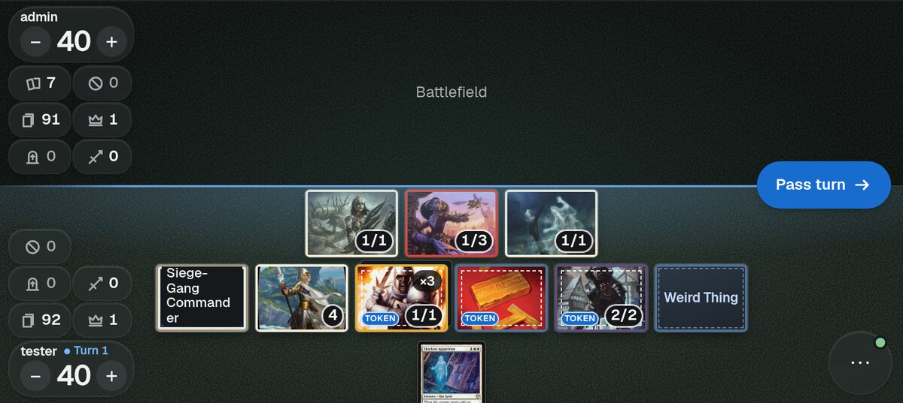

The ones made this visit, "one more", and the sheet when the dataset cannot load:

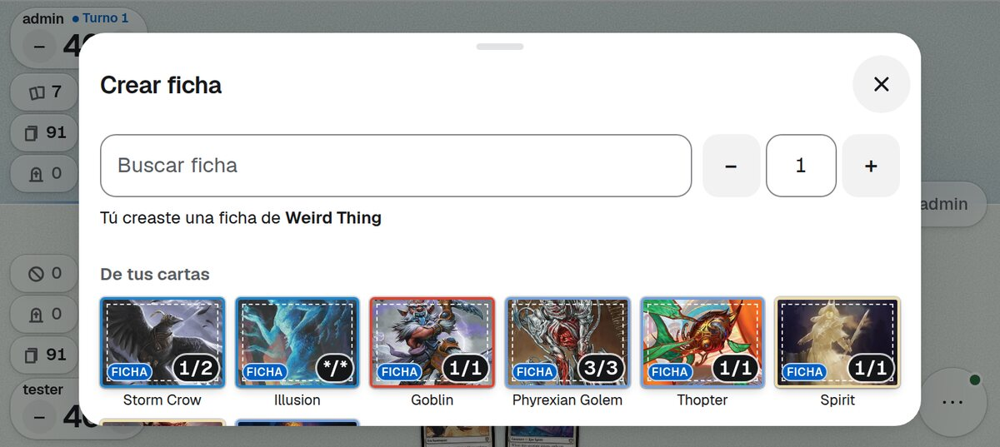
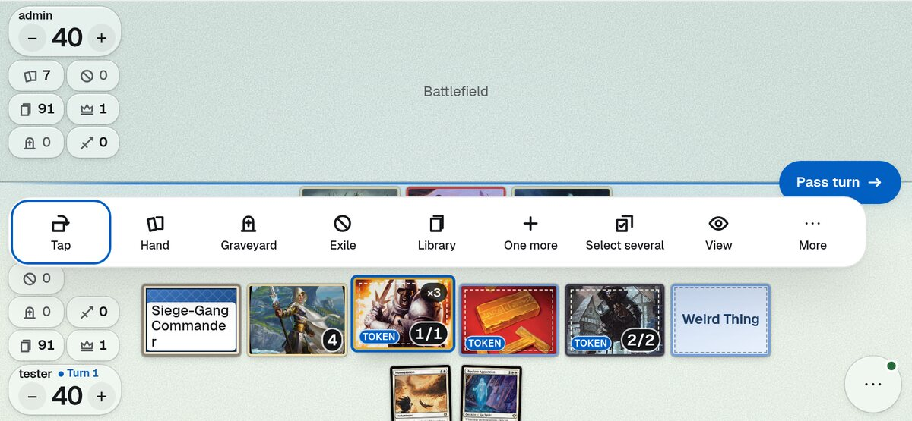
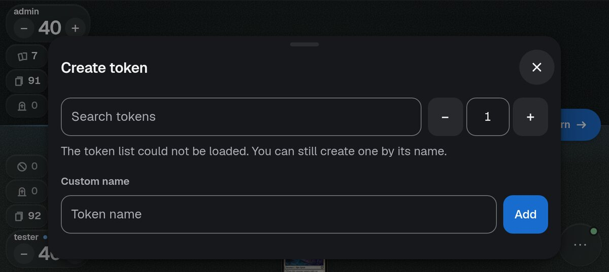

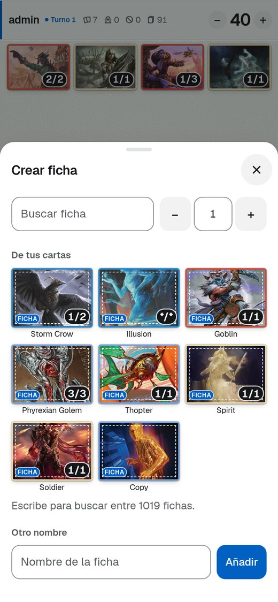

Not checked or weak in this step:
- Colour words in the search are English only ("green" works, "verde" does not).
- Several tokens share a name and power/toughness and differ only by art.
- The sheet is tight in landscape on a short phone: about two rows of tokens show at once.
- A face-down card adds nothing to "from your cards".
- A token whose image fails to load shows a blank tile.
- No real keyboard or thumb has used the sheet yet.

## Step 11 — Card handling (`cd3dd86`)

- **Double tap** is matched by time and place, not by the card under the second tap, and acts on the first tap's card. It works on a single card, on a stack and on a tapped card. A single tap still taps or untaps.
- **Hold, then let go** opens the card's actions; the held card shows large meanwhile. Holding and moving still drags.
- **The action bar** in landscape is a compact panel of 3 columns beside the card, at most 40% of the width.
- **Holding a card in a pile sheet** (graveyard, exile, library lists) shows it large above the sheet.

A yellow dot in the videos is the finger. Videos: [`10-card-handling/`](../../for_human_revision/10-card-handling/all_in_one.mp4).

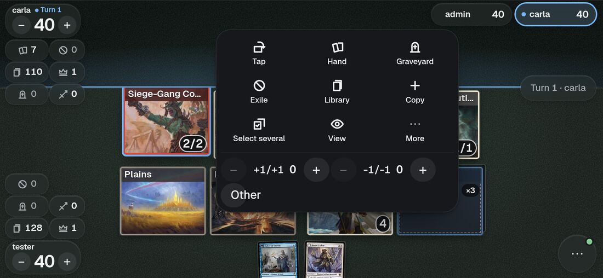
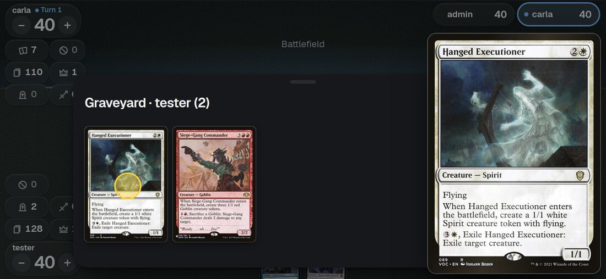

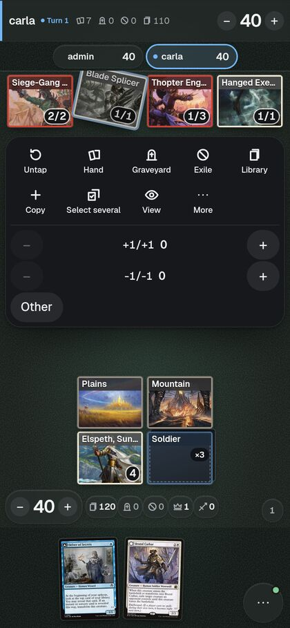

Try on a phone: tap twice fast on a creature, on a stack of tokens and on a tapped card; hold a card for half a second and let go; hold a card in the graveyard sheet.

Not checked or weak in this step:
- Nothing was tried on a real phone. The test double taps were sent by a headless browser, 20 of 20 worked there.
- The panel covers neighbouring cards while it is open, as before.
- In the videos holds look slower than a thumb because the browser sends the touch by script.

## Step 12 — The top of the card on tiles (`e37fe50`, look reworked after)

- A battlefield tile shows the top of the real printed card: its title bar (name and mana cost), then the art, cut just above the type line. It is the full card image enlarged a little inside the tile, so the black card border falls outside; the tile keeps its own coloured frame.
- Token panels do the same with the token's own card. Counters and the ×n badge sit just under the printed title bar; P/T or loyalty stays at the bottom corner.
- Our own name strip (long names cut with an ellipsis) only appears when a card has no image.
- At the smallest tile size the printed text is tiny, as on any small card; the large view has the name and the text.

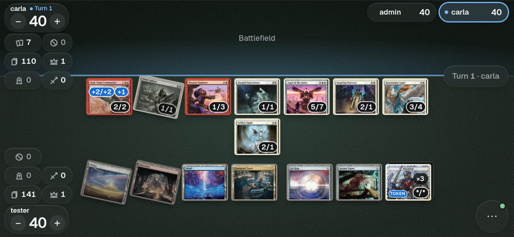
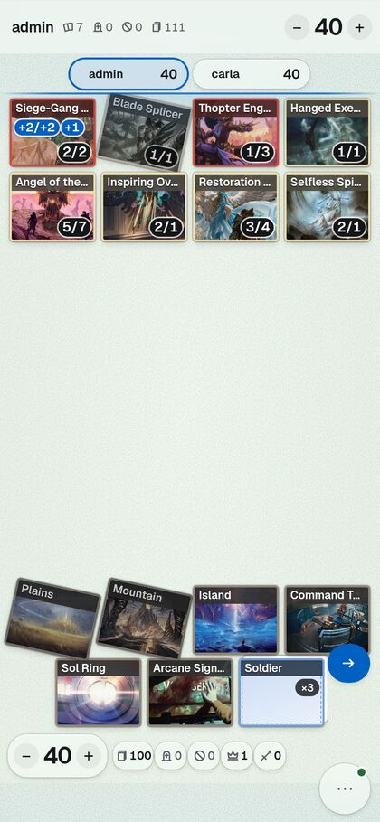

Videos: [`11-tile-titles-and-two-faced-cards/`](../../for_human_revision/11-tile-titles-and-two-faced-cards/all_in_one.mp4).

Try on a phone: a board with 8 creatures and 6 lands in landscape, then portrait.

Not checked or weak in this step:
- With 8 or more creatures on a landscape phone the printed title is a few pixels high and hard to read.
- Planeswalker and old-frame titles sit slightly higher; the bar is still visible but tight at the top edge.
- Battlefield tiles show only the first counter plus "+n".
- A token stack shows ×n and P/T close together on the smallest tiles.

## Step 13 — Two-faced cards (`e37fe50`, server `fb4c352`)

- **Transform** in the action bar of a two-faced card on the battlefield turns it (Delver of Secrets becomes Insectile Aberration, and back).
- **The large view** shows both faces side by side in landscape.
- **Play other face** in the hand's action bar puts the card on the battlefield turned (Valki, God of Lies arrives as Tibalt, Cosmic Impostor). Leaving the battlefield puts the front face back.
- The server has a `transform` action.

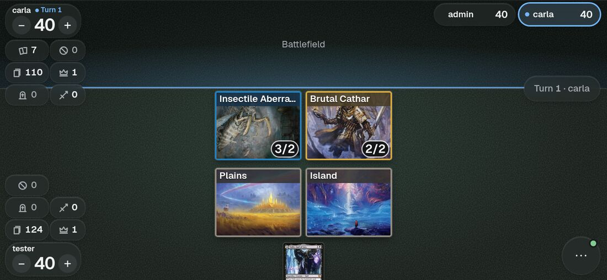
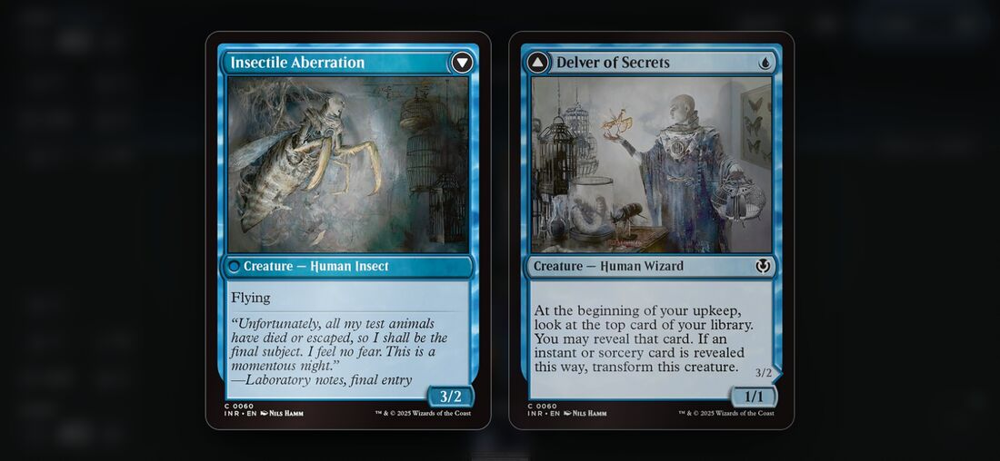
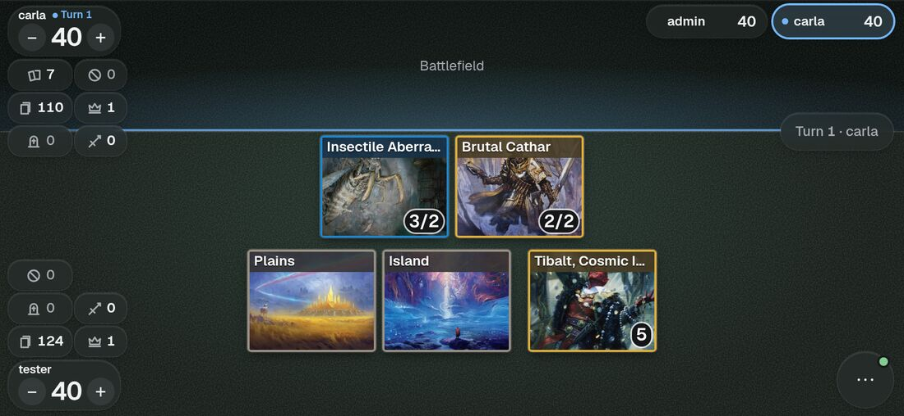
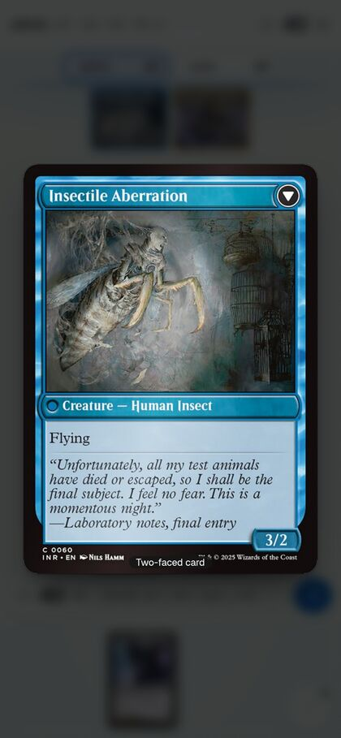

Try on a phone: double tap a Delver on the battlefield, Transform, then View; put Valki in your hand and use Play other face.

Not checked or weak in this step:
- Turning has no flip animation; the tile changes at once.
- In portrait the large view shows one face with a "Two-faced card" hint.
- A copy of a turned card copies the front face.
- Only Delver of Secrets and Valki were tried; cards with three or more parts (melds) were not.

## Step 14 — Tokens at hand (`fb4c352`, `f50de0b`)

- The token sheet has **Your deck** (the tokens your own cards make, read from the deck, not only from what is on the table) and **Other decks**, and a row of chips (You, then each other player) to say who gets the token. It goes back to You when reopened.
- A token made for another player goes onto that player's battlefield.
- **Copy** in the action bar copies a creature or a token, with its counters; it works on an opponent's card too.
- **The counter row** in the action bar: +1/+1 and −1/−1 with steppers, and Other.

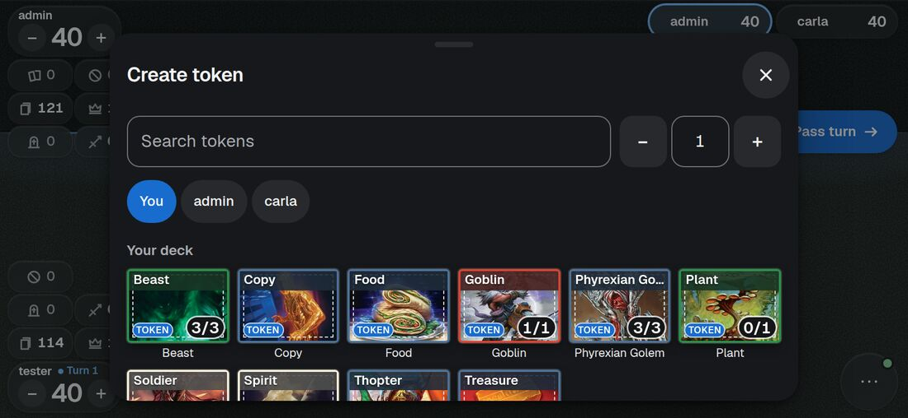
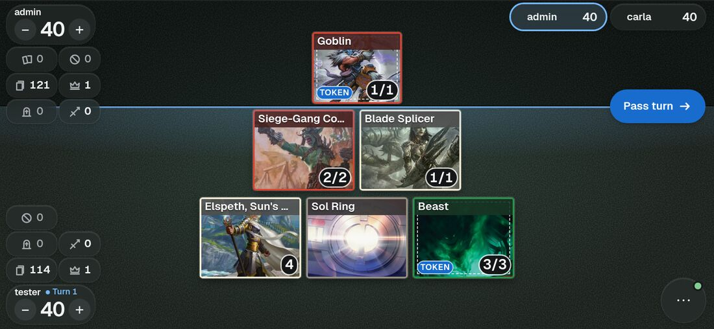
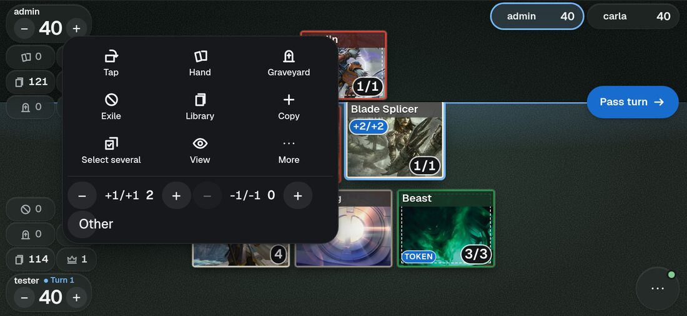
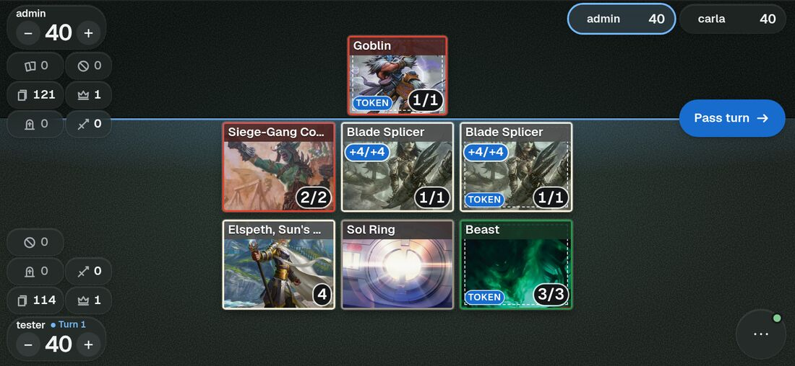
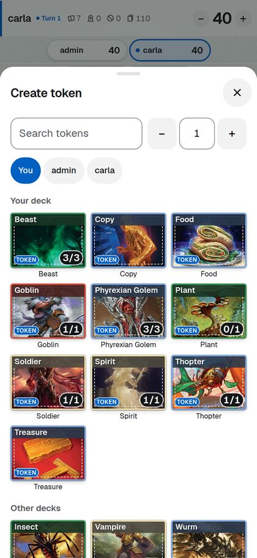

Videos: [`12-tokens-at-hand/`](../../for_human_revision/12-tokens-at-hand/all_in_one.mp4).

Try on a phone (3 players): open the token bubble, make one for you, pick another player's chip and make one for them; double tap a creature, add counters, Copy.

Not checked or weak in this step:
- "Other" counter opens the card's sheet rather than a small box.
- The sheet still says "Your deck" in the video while another player's chip is chosen; it lists the tokens of your own deck.
- A copy of a turned card copies the front face.
- The screen shows one other player at a time, so with three players a token made for someone is seen only while that player is on top.
- In landscape the sheet shows about one row of tokens at once.

## Step 15 — Lobby and decks (`e2b0f2b`, `f50de0b`)

- **The Games tab** picks the players with chips and has a Create game button; the game opens as a lobby.
- **The lobby** lists the players with their deck and Ready, and your deck as cards with the commander's art. Choosing a deck gives you a copy of it for this game, with tabs **Main, Sideboard and Maybeboard**. A card opens to move it to another board, one copy at a time; the change is saved a moment later. Ready locks the boards; the other player sees it live. When everyone is ready the table opens.
- **Decks keep** their sideboard and maybeboard (the importers read them, the server stores them).
- Board changes apply to that game only; the saved deck is not touched.

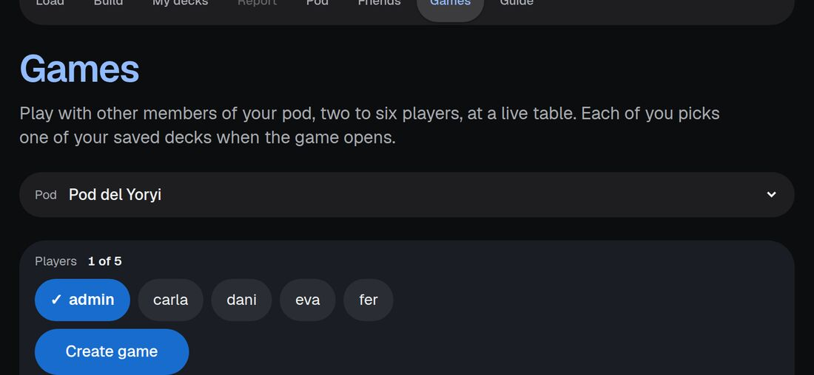


Videos: [`13-lobby-and-decks/`](../../for_human_revision/13-lobby-and-decks/all_in_one.mp4). They show two players on two screens at once.

Try on a phone, with a friend: create a game from the Games tab, each choose a deck, move a card from the Sideboard to Main, press Ready on one phone and watch the other.

Not checked or weak in this step:
- The lobby moves one copy at a time.
- Board rows show names only: no thumbnail and no large view.
- Deck cards show no card count.
- The state with no decks at all was not exercised, and the deck search (it shows from 9 decks) was only seen, not used.
- Decks saved before today have an empty sideboard and maybeboard until they are imported again.
- Board swaps apply to that game only, by design.
- The menus rework (a dock) is waiting for Jorge's choice.

## Step 16 — Library sheet count (`7f57f5e`)

- "How many from the top" starts at 1 and has − and + steppers and quick numbers 2, 3, 5, 7, 10. Draw, Mill, Exile, Look and Reveal "N" use it.


Video: the last clip of [`10-card-handling/`](../../for_human_revision/10-card-handling/all_in_one.mp4).

Not checked or weak in this step:
- The number field still opens the keyboard on a phone when tapped; the quick numbers avoid that (not tried on a phone).

## Step 17 — Library position (`5aca63d`)

- A card's action sheet has "Library · position": pick a number (quick numbers or the field, 1 is the top), then "Put it there". The card goes into your library at that place; the log says "position 7 from the top".
- One card at a time, and only into the owner's library.


Video: the last clip of [`10-card-handling/`](../../for_human_revision/10-card-handling/all_in_one.mp4).

## What comes next

Everything on the list is built. What remains is fixing what Jorge and his testers find on real phones, and the
weak spots listed under each step above.

New steps are added above this section as they are built.

## The checks

Run from the repository root; all must pass before a commit.

```
node scripts/test_engine_parity.js
node scripts/test_i18n.js
node scripts/test_table_log.js
node scripts/test_table_predict.js
python3 scripts/tier_rules.py --calibrate
cd server && python -m pytest
```
